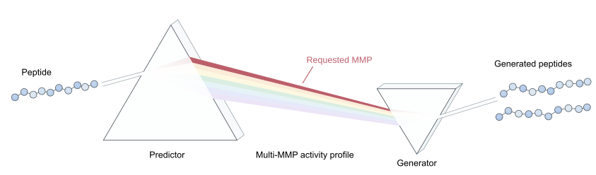
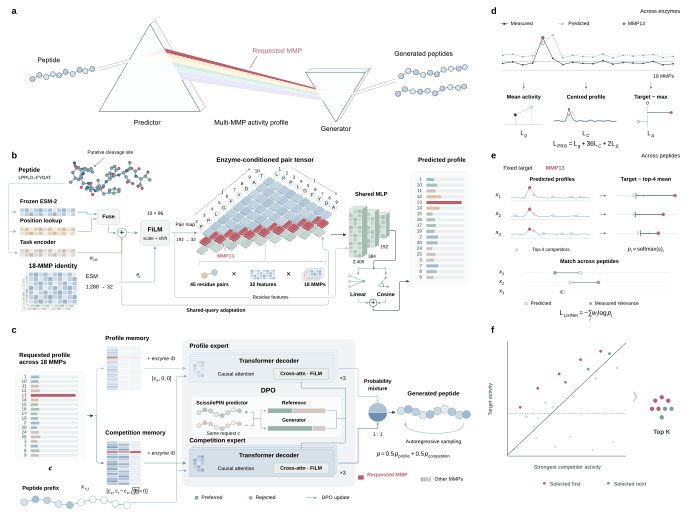

# ScissilePIN

**Scissile probe Prediction and Inverse design Network**

ScissilePIN predicts peptide cleavage across 18 matrix metalloproteinases (MMPs) and designs candidate substrates for each enzyme. To our knowledge, ScissilePIN is the first conditional generator shown to produce candidates with predicted activity and selectivity for every one of the 18 MMPs in this panel. For each target, qualifying peptides exceed the target activity threshold and have higher predicted cleavage by that MMP than by any of the other 17.

The predictor estimates an 18-enzyme activity profile for each peptide. The generator combines profile and competition experts trained with direct preference optimization to design peptides for a requested activity profile.

Supported targets: **MMP1, MMP2, MMP3, MMP7, MMP8, MMP9, MMP10, MMP11, MMP12, MMP13, MMP14, MMP15, MMP16, MMP17, MMP19, MMP20, MMP24 and MMP25**.

This repository provides pretrained predictor and generator weights, their training pipelines, and tools for peptide generation, prediction and evaluation.



## Table of contents

- [Getting started](#getting-started)
  - [Installation](#installation)
  - [Project structure](#project-structure)
  - [Check the installation](#check-the-installation)
- [Training models](#training-models)
  - [ScissilePIN predictor](#scissilepin-predictor)
  - [ScissilePIN generator full training pipeline](#scissilepin-generator-full-training-pipeline)
- [Predicting peptide activity](#predicting-peptide-activity)
- [Generating peptides](#generating-peptides)
  - [Generate and score](#generate-and-score)
  - [Single-checkpoint generation and evaluation](#single-checkpoint-generation-and-evaluation)
- [Run settings](#run-settings)
- [Data](#data)
  - [Predictor data](#predictor-data)
  - [Generator data](#generator-data)
- [Outputs](#outputs)

## Getting started

### Installation

Use Python 3.12. Run all commands from the repository root.

```sh
python3.12 -m venv .venv
source .venv/bin/activate
python -m pip install -r requirements/predictor.txt -r requirements/generator.txt
```

### Project structure

```text
ScissilePIN/
├── predictor/                 # Activity prediction and training
│   ├── checkpoints/           # Released predictor weights (seeds 0, 1, 2)
│   ├── initialization/        # Pretrained task-LM weights and enzyme inputs
│   └── configs/               # Fixed predictor training settings
├── generator/                 # Peptide generation and full training pipeline
│   ├── checkpoints/           # Released generator weights (seeds 0, 1, 2)
│   ├── initialization/        # Supervised initialization for DPO
│   ├── configs/               # Generation and fixed training settings
│   └── data/                  # Fitting data, preference pairs and requested profiles
├── data/                      # Predictor training, validation, test and OOD data
├── evaluation/                # Prediction and generation evaluation scripts
├── requirements/              # Python dependencies
├── tests/                     # Model loading, prediction and training checks
├── assets/                    # Images used in this README
├── README.md                  # Installation, commands and data formats
└── run.sh                     # Training, prediction, generation and evaluation entry point
```

### Check the installation

```sh
bash run.sh verify
DEVICE=cpu bash run.sh smoke
```

The smoke check loads all three predictor and generator checkpoints and generates 50 attempts per generator.

## Training models



### ScissilePIN predictor

```sh
# Train all three seeds:
DEVICE=cuda FEATURE_PRECISION=bf16 bash run.sh train-predictor
# One seed, or resume interrupted training:
SEEDS="0" DEVICE=cuda bash run.sh train-predictor
SEEDS="0" RESUME=1 DEVICE=cuda bash run.sh train-predictor
```

Training runs three stages: task-backbone training, pretrained task-LM integration, and shared-query adapter training. ESM features remain frozen. The task-LM initialization is included in `predictor/initialization/`; training settings are in `predictor/configs/prism.json`.

Models are saved to `outputs/predictor/training/seed{0,1,2}/final.pt`. Pass a new model to `predictor/predict.py --checkpoint` to use it for prediction.

### ScissilePIN generator full training pipeline

The training environment uses Python 3.12, PyTorch 2.6.0, NumPy 2.3.2 and pandas 2.3.0:

```sh
python3.12 -m venv .venv-generator
.venv-generator/bin/python -m pip install -r requirements/generator-training.txt
export GENERATOR_PYTHON="$PWD/.venv-generator/bin/python"
```

```sh
# Full training, all three seeds:
DEVICE=cuda bash run.sh train-generator
# Train the 18-target stages from the packaged pretrained mixture:
FROM_INITIALIZATION=1 DEVICE=cuda bash run.sh train-generator
# Resume one seed:
SEEDS="0" RESUME=1 DEVICE=cuda bash run.sh train-generator
```

The training stages are base decoder pretraining (150 epochs), refinement (60), profile and competition experts (300 each), supervised mixture training (60), 18-target supervised adaptation (60), and standard DPO (1,000 updates). Adaptation selects the minimum mean development NLL across the 18 targets; DPO averages the 18 per-target mean gradients and retains the final update. Seed 0 uses two GPUs for adaptation and DPO; seeds 1 and 2 use one each.

Released weights are `generator/checkpoints/generator_SEED0.pt`, `generator_SEED1.pt` and `generator_SEED2.pt`. Training writes new weights to `outputs/generator/training/seed*/generator_SEED*.pt`. The exact DPO starting states are in `generator/initialization/adapted_SEED*.pt`; `DEVICE=cuda bash run.sh train-generator-dpo` trains from them. Settings and checkpoint hashes are in `generator/configs/`.

## Predicting peptide activity

```sh
DEVICE=cuda FEATURE_PRECISION=bf16 bash run.sh predictor
# CPU:
# DEVICE=cpu FEATURE_PRECISION=fp32 bash run.sh predictor
```

This evaluates validation, benchmark test and OOD sequences with seeds 0, 1 and 2. ESM-2 650M is downloaded on first use; extracted features are cached in `outputs/features/`.

For custom ten-residue sequences, provide a CSV with a `sequence` column:

```sh
python predictor/extract_features.py --input peptides.csv --output features.npz --device cuda --precision bf16
python predictor/predict.py --checkpoint predictor/checkpoints/seed0.pt \
  --input features.npz --output predictions.npz --device cuda
```

The output NPZ contains the input sequences, enzyme names and an N × 18 array of predicted activities.

## Generating peptides

### Generate and score

```sh
# Generate substrates for one MMP:
TARGET=MMP1 DEVICE=cuda bash run.sh generator
# Generate for all 18 MMPs:
TARGET=all DEVICE=cuda bash run.sh generator
# Score the generated pools and rank candidates for their requested enzyme:
DEVICE=cuda bash run.sh score-generated
```

By default, each checkpoint generates 400 attempts per template from 50 target-specific profiles, with two sampling repeats. `SEEDS="0"` selects one checkpoint. Each pool records its target, target index, request, training seed and sampling seed. Scoring exports all 18 predicted activities and ranks Top24/Top100 candidates by `min(target − 1, target − max(other 17))`.

### Single-checkpoint generation and evaluation

```sh
python generator/sample.py --checkpoint generator/checkpoints/generator_SEED0.pt \
  --target MMP9 --device cpu --per-template 1 --output outputs/MMP9.csv
python generator/evaluate_checkpoint.py --checkpoint generator/checkpoints/generator_SEED0.pt \
  --target all --device cuda --output outputs/development_nll.json
```

`REQUEST=g1_original50` is the default measured-profile request; `fit_paper` uses predicted fitting profiles. The `observed` and `counterfactual` requests reproduce the main-text sampling protocol with `PER_TEMPLATE=40 SAMPLING_SEEDS="2026112101 2026112102"`. The request selects its matching templates, sampling kernel and novelty exclusions. `MODE=unconditional` generates without profile conditioning. Use `--help` for script options.

## Run settings

| Variable | Default | Use |
| --- | --- | --- |
| `DEVICE` | `cuda` | `cuda` or `cpu` |
| `FEATURE_PRECISION` | `bf16` | Use `fp32` for CPU feature extraction |
| `SEEDS` | `0 1 2` | Checkpoints to run |
| `TARGET` | `all` | One supported MMP or all 18 |
| `REQUEST` | `g1_original50` | Request profiles and sampling protocol |
| `FROM_INITIALIZATION` | `0` | Set `1` to start training from the packaged pretrained mixture |
| `MODE` | `selective` | `selective` or `unconditional` |
| `TEMPERATURE` | `1.2` / `1.0` | Conditional / unconditional sampling |
| `PER_TEMPLATE` | `400` | Attempts per profile |
| `SAMPLING_SEEDS` | `2026111201 2026111202` | Sampling repeats |
| `OUTPUT_DIR` | `outputs/` | Output directory |
| `FEATURE_DIR` | `$OUTPUT_DIR/features/` | Feature cache |
| `POOL_DIR` | `$OUTPUT_DIR/generator/pools/` | Generated pools to score |
| `RESUME` | `0` | Set `1` to resume predictor or generator training |
| `PREDICTOR_LM_INIT` | `predictor/initialization/lmw_256_8_iso.pt` | Task-LM initialization |

`PYTORCH_PYTHON`, `GENERATOR_PYTHON` and `METRICS_PYTHON` can select separate Python executables. Run `bash run.sh help` for available commands.

## Data

### Predictor data

| Split | Peptides | Measured enzymes | Files |
| --- | ---: | ---: | --- |
| Training | 13,666 | 18 | `data/benchmark/train.csv`, `train.npz` |
| Validation | 1,200 | 18 | `data/benchmark/val.csv`, `val.npz` |
| Benchmark test | 2,901 | 18 | `data/benchmark/test.csv`, `test.npz` |
| OOD | 80 | 12 | `data/ood/ood.csv`, `ood.npz` |

Benchmark CSVs contain `sequence` followed by 18 activity columns. The matching NPZ files contain sequences, measured labels, rounded conditions and tokens. Split membership and enzyme orders are provided in `data/split_ids.json` and each dataset’s `target_order.json`.

Benchmark data use cleavage Z-scores; OOD data use published experimental efficiencies. OOD evaluation uses thresholds derived from those measurements. Data sources and preprocessing are documented in `data/source_manifest.json`.

### Generator data

`generator/data/` contains the 10,954-sequence fitting split, 1,434-sequence development split, three seed-specific preference tables, all 18 target request profiles, and the corresponding novelty exclusion sets. `target_order.json` defines the common enzyme-column order for generation, evaluation and scoring. `requests_18.json` supplies the conditions used for standard-DPO training; `templates_18.json` supplies the supplementary generation profiles. Training uses the fixed packaged preference pairs.

## Outputs

| Location under `OUTPUT_DIR` | Contents |
| --- | --- |
| `predictor/predictions/` | NPZ files containing sequences, enzyme order and predictions |
| `predictor/metrics/` | Aggregate/per-target metrics, selected peptides and thresholds |
| `predictor/training/seed*/` | Newly trained predictor, per-stage checkpoints and histories |
| `generator/nll/` | Generator development loss |
| `generator/pools/` | Raw generated sequences |
| `generator/quality/` | Sequence-quality summaries |
| `generator/prism_scores/` | Predicted activity profiles, scores and selected peptides |
| `generator/training/seed*/` | Complete generator training: stage checkpoints, histories and final model |
| `generator/dpo/seed*/` | Standard-DPO weights trained from the supplied 18-target initialization |
